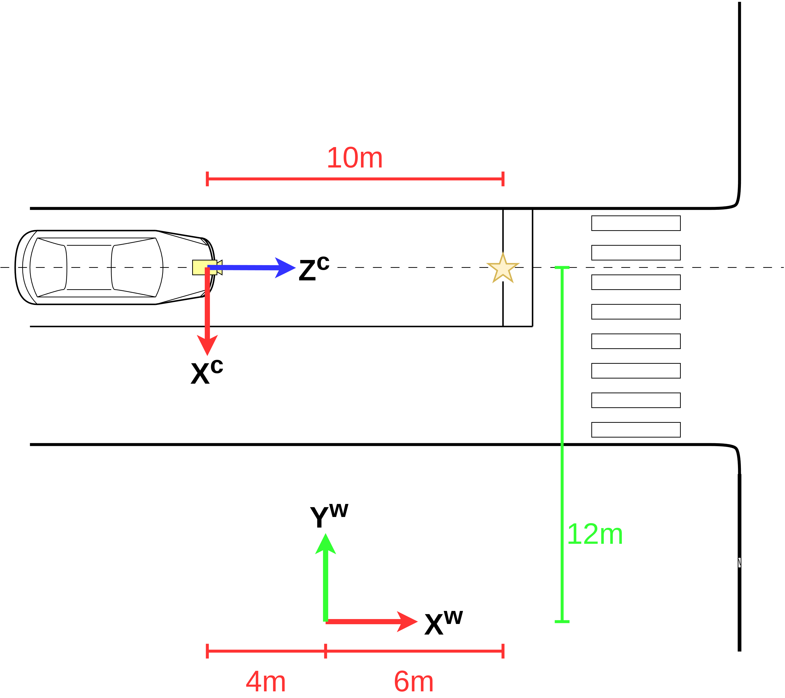
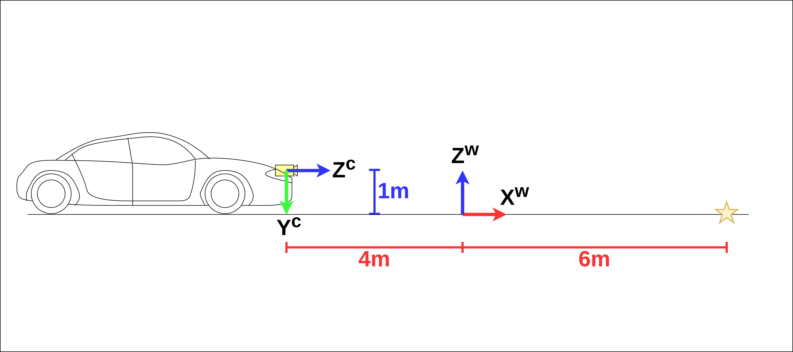

.. _projection_matrix:

射影行列
========

**著者** 石田 岳志 `サイバーエージェント AI Lab <https://research.cyberagent.ai/>`__

スマートフォンでかざすだけで、目の前の風景にキャラクターが浮かび上がる。そんな拡張現実(AR)の技術をみなさんも体験したことがあるかもしれません。ARゲームでスマートフォンをかざすと、キャラクターが目の前の公園や地面に現れます。

これらのアプリはどのようにして、現実世界の正確な位置に仮想的な物体を表示しているのでしょうか。公園の地面に物体やキャラクターを配置するには、「現実世界の特定の位置が、スマートフォンの画面のどこに映っているか」を正確に計算する必要があります。この計算を可能にするのが、今回解説する **射影行列 (Projection Matrix)** です。

射影行列は、現実世界の3次元座標を画像上の2次元座標に変換する道具です。AR技術だけでなく、カメラを使うあらゆる技術の根幹を支えています。

これまでに、ピンホールカメラモデルと座標変換という2つの重要な概念を学んできました。今回はこの2つを組み合わせることで、現実世界と画像をつなぐ射影行列の仕組みを理解していきます。

前回までの復習
--------------

これまでに、:ref:`pinhole_camera_model` のページでピンホールカメラモデルについて学び、3次元空間上の点をカメラに投影する方法を理解しました。また、:ref:`coordinate_transform` のページではワールド座標系とカメラ座標系の変換方法を学びました。

ピンホールカメラモデルでは、カメラ座標系における3次元点 :math:`\mathbf{p}^{c} = \begin{bmatrix} X^{c} & Y^{c} & Z^{c} \end{bmatrix}^{\top}` を画像座標 :math:`(u, v)` に投影する式が次のように与えられました。

.. math::
   Z^{c} \begin{bmatrix} u \\ v \\ 1 \end{bmatrix}
   =
   K\mathbf{p}^{c}

ここで :math:`Z^{c}` はカメラ座標系における点 :math:`\mathbf{p}^{c}` のZ座標、すなわちカメラ光軸方向の奥行きを表します。また :math:`K` は内部行列で、焦点距離とオフセットを含むカメラ固有のパラメータです。

.. math::
   K =
   \begin{bmatrix}
   f_{x} & 0     & c_{x} \\
   0     & f_{y} & c_{y} \\
   0     & 0     & 1     \\
   \end{bmatrix}

また、座標変換のページでは、ワールド座標系の点 :math:`\mathbf{p}^{w} = \begin{bmatrix} X^{w} & Y^{w} & Z^{w} \end{bmatrix}^{\top}` をカメラ座標系の点 :math:`\mathbf{p}^{c}` に変換する方法を学びました。

.. math::
   \mathbf{p}^{c}
   =
   R^{cw}\mathbf{p}^{w}
   +
   \mathbf{t}^{cw}

ここで :math:`R^{cw}` は回転行列、 :math:`\mathbf{t}^{cw}` は並進ベクトルです。

射影行列とは
------------

実際の3次元復元や位置推定のアプリケーションでは、ワールド座標系で表現される地図上の物体を画像座標に投影する計算を何度も繰り返し行います。

前回の記事の最後で見たように、ワールド座標系の点を画像座標に投影するには、座標変換とカメラへの投影という2つのステップを組み合わせる必要があります。

.. math::
   Z^{c} \begin{bmatrix} u \\ v \\ 1 \end{bmatrix}
   =
   K
   \left(
   R^{cw}\mathbf{p}^{w}
   +
   \mathbf{t}^{cw}
   \right)

この式は正しいのですが、毎回この2段階の計算を書くのは面倒です。そこで登場するのが **射影行列** です。射影行列を使うと、ワールド座標系の点から画像座標への投影をたった1回の行列演算で表現できます。

射影行列の定義
--------------

同次座標表現を使うと、座標変換とカメラへの投影を1つの式にまとめることができます。ワールド座標系の点を同次座標で表現したものを :math:`\dot{\mathbf{p}^{w}} = \begin{bmatrix} X^{w} & Y^{w} & Z^{w} & 1 \end{bmatrix}^{\top}` とすると、投影の式は次のようになります。

.. math::
   :label: projection_with_homogeneous

   Z^{c} \begin{bmatrix} u \\ v \\ 1 \end{bmatrix}
   =
   K
   \begin{bmatrix}
   \begin{array}{ccc|c}
      &        & &                 \\
      & R^{cw} & & \mathbf{t}^{cw} \\
      &        & &                 \\
   \end{array}
   \end{bmatrix}
   \begin{bmatrix}
     X^{w}  \\
     Y^{w}  \\
     Z^{w}  \\
     1      \\
   \end{bmatrix}

この式の右辺にある :math:`K` と :math:`\begin{bmatrix} R^{cw} & \mathbf{t}^{cw} \end{bmatrix}` の積を計算してひとつの行列にまとめたものが射影行列です。射影行列を :math:`P` とすると、

.. math::
   :label: projection_matrix_definition

   P
   =
   K
   \begin{bmatrix}
   \begin{array}{ccc|c}
      &        & &                 \\
      & R^{cw} & & \mathbf{t}^{cw} \\
      &        & &                 \\
   \end{array}
   \end{bmatrix}

と定義されます。射影行列 :math:`P` は3行4列の行列です。これを使うと、ワールド座標系の点から画像座標への投影を非常にシンプルに表現できます。

.. math::
   :label: projection_with_matrix

   Z^{c} \begin{bmatrix} u \\ v \\ 1 \end{bmatrix}
   =
   P
   \begin{bmatrix}
     X^{w}  \\
     Y^{w}  \\
     Z^{w}  \\
     1      \\
   \end{bmatrix}

この式を見てください。ワールド座標系の点 :math:`(X^{w}, Y^{w}, Z^{w})` を同次座標で表現したものに射影行列 :math:`P` を掛けるだけで、画像座標 :math:`(u, v)` が得られます。

内部パラメータと外部パラメータ
------------------------------

射影行列の構造をもう少し詳しく見てみましょう。 :eq:`projection_matrix_definition` を見ると、射影行列は2つの部分から構成されていることがわかります。

1つ目は内部行列 :math:`K` です。これは :ref:`pinhole_camera_model` のページで学んだように、焦点距離 :math:`f_{x}, f_{y}` とオフセット :math:`c_{x}, c_{y}` というカメラ固有のパラメータで構成されています。これらのパラメータはカメラの構造によって決まるもので、カメラの向きや位置を変えても変化しません。このため、内部行列 :math:`K` に含まれるパラメータは **内部パラメータ** と呼ばれます。

2つ目は回転行列 :math:`R^{cw}` と並進ベクトル :math:`\mathbf{t}^{cw}` です。これらは :ref:`coordinate_transform` のページで学んだように、ワールド座標系とカメラ座標系の位置関係を表しています。カメラの位置や向きが変わると、これらのパラメータも変化します。カメラの外側の世界との関係を表すパラメータという意味で、回転行列と並進ベクトルは **外部パラメータ** と呼ばれます。

つまり、射影行列 :math:`P` は内部パラメータと外部パラメータの両方を含んでおり、「このカメラで、この場所・この向きから撮影すると、ワールド座標系の点はどこに写るか」という情報を1つの行列にまとめているのです。

具体例で計算してみる
--------------------

それでは、:ref:`coordinate_transform` のページで扱った自動車の例を使って、実際に射影行列を計算してみましょう。

   自動車と停止線の位置関係（上から見た図）

   自動車と停止線の位置関係（横から見た図）

前回の記事では、停止線のワールド座標系での位置が :math:`(X^{w}, Y^{w}, Z^{w}) = (6, 12, 0)` であり、カメラの内部パラメータが :numref:`camera_parameters_example` のように与えられていました。

.. table:: カメラの内部パラメータ（再掲）
   :name: camera_parameters_example

   ===============   ===========
   パラメータ        数値
   ===============   ===========
   X方向焦点距離     500ピクセル
   Y方向焦点距離     500ピクセル
   X方向オフセット   180ピクセル
   Y方向オフセット   120ピクセル
   ===============   ===========

また、外部パラメータは次のように与えられていました。

.. math::
   R^{cw} &=
   \begin{bmatrix}
     0 & -1 & 0 \\
     0 & 0 & -1 \\
     1 & 0 & 0 \\
   \end{bmatrix} \\
   \mathbf{t}^{cw} &=
   \begin{bmatrix}
     12 \\
     1  \\
     4  \\
   \end{bmatrix}

射影行列の計算
~~~~~~~~~~~~~~

それでは射影行列 :math:`P` を計算しましょう。まず内部行列 :math:`K` は :numref:`camera_parameters_example` より次のようになります。

.. math::
   K =
   \begin{bmatrix}
   500 &   0 & 180  \\
     0 & 500 & 120  \\
     0 &   0 &   1  \\
   \end{bmatrix}

次に、外部パラメータを並べた行列を作ります。

.. math::
   \begin{bmatrix}
   \begin{array}{ccc|c}
      &        & &                 \\
      & R^{cw} & & \mathbf{t}^{cw} \\
      &        & &                 \\
   \end{array}
   \end{bmatrix}
   =
   \begin{bmatrix}
     0 & -1 & 0 & 12  \\
     0 &  0 & -1 & 1   \\
     1 &  0 &  0 & 4  \\
   \end{bmatrix}

射影行列は内部行列 :math:`K` と外部パラメータの行列の積で求められます。

.. math::
   :label: projection_matrix_calculation

   P
   &=
   K
   \begin{bmatrix}
     0 & -1 & 0 & 12  \\
     0 &  0 & -1 & 1   \\
     1 &  0 &  0 & 4  \\
   \end{bmatrix} \\
   &=
   \begin{bmatrix}
   500 &   0 & 180  \\
     0 & 500 & 120  \\
     0 &   0 &   1  \\
   \end{bmatrix}
   \begin{bmatrix}
     0 & -1 & 0 & 12  \\
     0 &  0 & -1 & 1   \\
     1 &  0 &  0 & 4  \\
   \end{bmatrix} \\
   &=
   \begin{bmatrix}
   180 & -500 &    0 & 6720  \\
   120 &    0 & -500 &  980  \\
     1 &    0 &    0 &    4  \\
   \end{bmatrix}

これで射影行列が求まりました。

射影行列を使った投影
~~~~~~~~~~~~~~~~~~~~

それでは、この射影行列を使って停止線を画像座標に投影してみましょう。停止線のワールド座標は :math:`(X^{w}, Y^{w}, Z^{w}) = (6, 12, 0)` でした。

.. math::
   :label: projection_calculation_example

   Z^{c} \begin{bmatrix} u \\ v \\ 1 \end{bmatrix}
   &=
   P
   \begin{bmatrix}
     X^{w}  \\
     Y^{w}  \\
     Z^{w}  \\
     1      \\
   \end{bmatrix} \\
   &=
   \begin{bmatrix}
   180 & -500 &    0 & 6720  \\
   120 &    0 & -500 &  980  \\
     1 &    0 &    0 &    4  \\
   \end{bmatrix}
   \begin{bmatrix}
     6   \\
     12  \\
     0   \\
     1   \\
   \end{bmatrix} \\
   &=
   \begin{bmatrix}
     1800  \\
     1700  \\
     10  \\
   \end{bmatrix}

3行目の値から :math:`Z^{c} = 10` であることがわかるので、これを使って画像座標を計算します。

.. math::
   \begin{bmatrix} u \\ v \\ 1 \end{bmatrix}
   &=
   \frac{1}{Z^{c}}
   \begin{bmatrix}
     1800  \\
     1700  \\
     10  \\
   \end{bmatrix} \\
   &=
   \frac{1}{10}
   \begin{bmatrix}
     1800  \\
     1700  \\
     10  \\
   \end{bmatrix} \\
   &=
   \begin{bmatrix}
     180  \\
     170  \\
     1  \\
   \end{bmatrix}

したがって、停止線は画像の左上から右に180ピクセル、下に170ピクセルの位置に写ることがわかりました。これは前回の記事で2段階に分けて計算した結果と完全に一致します。しかし、射影行列を使うことで、計算がずっとシンプルになったことがおわかりいただけると思います。

射影行列の利点
--------------

計算の効率化
~~~~~~~~~~~~

射影行列の最大の利点は、計算を効率化できることです。3次元復元や位置推定のアルゴリズムでは、何千、何万という3次元点を画像に投影する計算を繰り返し行います。このとき、毎回「座標変換してから投影」という2段階の計算を書くよりも、射影行列を一度計算しておいて、あとはそれを使うだけの方が圧倒的に効率的です。

式の見通しの良さ
~~~~~~~~~~~~~~~~

射影行列を使うと、計算をシンプルな形で表現できます。 :eq:`projection_with_matrix` を見てください。

.. math::
   Z^{c} \begin{bmatrix} u \\ v \\ 1 \end{bmatrix}
   =
   P
   \begin{bmatrix}
     X^{w}  \\
     Y^{w}  \\
     Z^{w}  \\
     1      \\
   \end{bmatrix}

この式は「ワールド座標系の点を行列 :math:`P` で変換すると画像座標が得られる」という関係を明確に示しています。内部パラメータと外部パラメータの詳細を気にせず、全体の関係性を把握しやすくなります。

まとめ
------

射影行列は、ワールド座標系の点を画像座標に投影するための3行4列の行列です。内部行列 :math:`K` と外部パラメータ :math:`[R^{cw} | \mathbf{t}^{cw}]` の積として定義されます。

.. math::
   P
   =
   K
   \begin{bmatrix}
   \begin{array}{ccc|c}
      &        & &                 \\
      & R^{cw} & & \mathbf{t}^{cw} \\
      &        & &                 \\
   \end{array}
   \end{bmatrix}

射影行列を使うと、ワールド座標系の点から画像座標への投影を1回の行列演算で表現できます。

.. math::
   Z^{c} \begin{bmatrix} u \\ v \\ 1 \end{bmatrix}
   =
   P
   \begin{bmatrix}
     X^{w}  \\
     Y^{w}  \\
     Z^{w}  \\
     1      \\
   \end{bmatrix}

内部パラメータと外部パラメータという2つの異なる性質のパラメータを1つの行列にまとめることで、複雑な計算を簡潔に記述できます。
